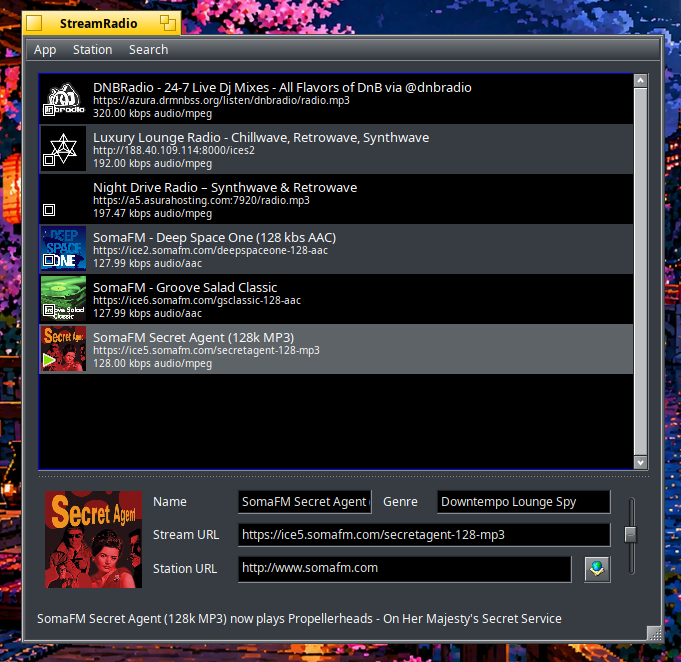

#  StreamRadio [](https://www.haiku-os.org/)  [](https://www.gnu.org/licenses/gpl-3.0.html) 

StreamRadio is a native Haiku application for finding and listening to internet
radio stations.

Search the [Community Radio Browser](https://www.radio-browser.info/) directory,
add stations to your collection, inspect and edit station details, and control
the volume of each stream. StreamRadio also supports direct Shoutcast URLs and
optional parallel playback of multiple stations. A sleep timer can stop or mute
playback, or quit StreamRadio, at the top of the hour or after a preset delay.
The main window also offers mini-player, maximum-height, and fullscreen modes.



---

This project was originally written by a dedicated team of talented coders who
laid a strong and thoughtful foundation. After the original project became
dormant, this independent fork began modernising that foundation for current
Haiku releases, improving stream reliability and continuing development without
being constrained to maintenance-only changes.

**The goal is simple:** to make it the best internet radio app on Haiku.

Credit to the original authors and past contributors, whose work this builds
directly upon.

> Sikosis · **Maintainer** · [GitHub](https://github.com/sikosis)

---

## Building on 32-bit Haiku

> [!IMPORTANT]
> When building on 32-bit Haiku, change the build environment to `gcc11` with
> `setarch x86` before invoking `make`.

---

## Build

From the repository root, run:

```sh
mkdir -p dist
cd source
make
make bindcatalogs
```

The application is written to `dist/StreamRadio`.

For a 32-bit build, run the build commands through `setarch`:

```sh
mkdir -p dist
cd source
setarch x86 make
setarch x86 make bindcatalogs
```

---

## Package

On Haiku, build an installable package after compiling StreamRadio:

```sh
cd source
make package
```

The package is written to:

```text
dist/StreamRadio-1.2.1-<architecture>.hpkg
```

Install it with `pkgman`, substituting the generated filename:

```sh
pkgman install ./dist/StreamRadio-1.2.1-x86_64.hpkg
```

> [!WARNING]
> The package target recreates its staging directory. Keep any files you need
> outside `dist/package`.

---

## Documentation

For installation and usage instructions, see the
[StreamRadio user guide](docs/userguide.md).

Bug reports and feature requests are welcome in the
[StreamRadio issue tracker](https://github.com/sikosis/StreamRadio/issues).

---

## License

StreamRadio is free software licensed under the
[GNU General Public License, version 3](https://www.gnu.org/licenses/gpl-3.0.html).
Third-party components and their licenses are listed in the application's
About window.
